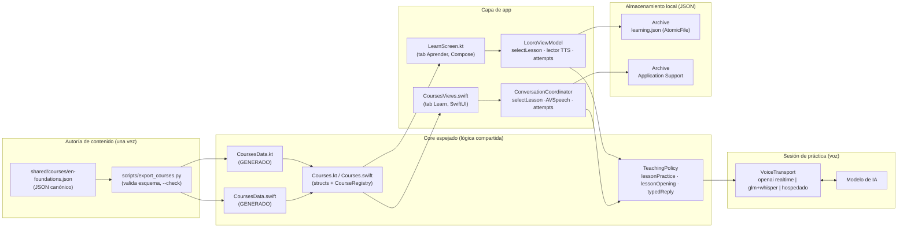
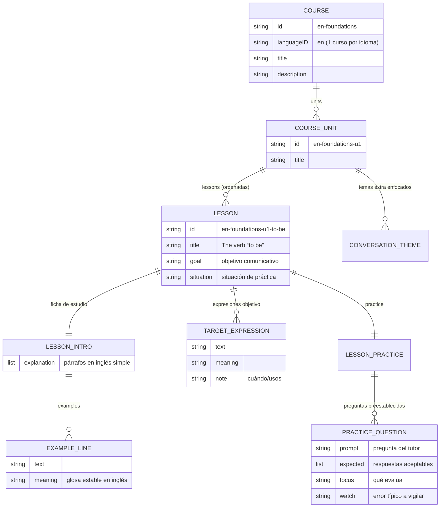
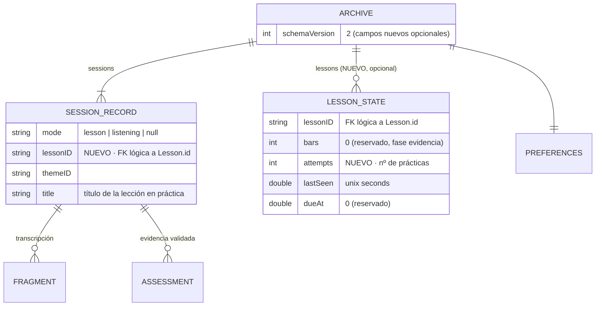
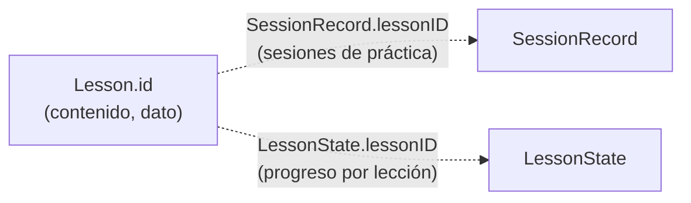
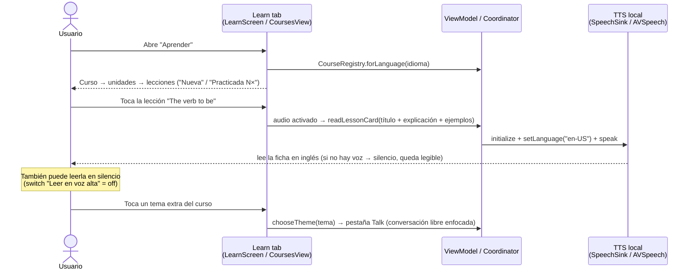
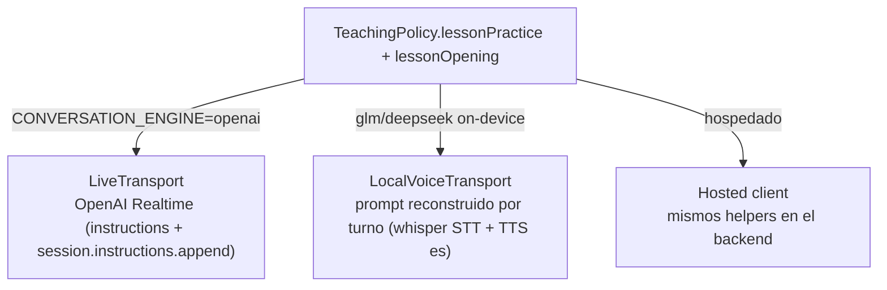

# Informe de diagramas — cómo quedó implementado courses-and-lessons

**Fecha:** 2026-09-21 · **Rama:** `feature/switchable-conversation-engine`
**Alcance:** documentación visual (diagramas) de la funcionalidad implementada en `openspec/changes/courses-and-lessons/` (commits `9909890`→`08160b1`): modelo de datos, almacenamiento real (no hay BD SQL: contenido compilado + Archive JSON local) y flujos usuario↔app. Diagramas en Mermaid, renderizables en GitHub/VS Code.

---

## 1. Arquitectura general

El contenido de los cursos es **dato compilado dentro de la app** (autoría una vez, generado a las dos plataformas); el progreso es **Archivo JSON local**; la práctica reutiliza la sesión de voz existente.



Garantía de no divergencia: `export_courses.py --check` + `check_cross_platform.py` (palabra de los prompts y campos de Archive).

---

## 2. Modelo de datos

### 2.1 Contenido embebido (solo lectura, compilado en la app)



`CONVERSATION_THEME` es el tipo que ya existía para Temas: los temas del curso se abren con el mismo cableado (steering incluido).

### 2.2 Datos de usuario (Archive local — lo nuevo en negrita)



**Relación lógica entre ambos mundos** (no hay FK real; se resuelve con `CourseRegistry.lesson(id)`):



Reglas del Archive que se respetan: campos nuevos **opcionales** (los backups anteriores siguen importando), `lessons` limitado a 1000 entradas, fusión de importes por **máximo progreso**, fixture compartido `shared/fixtures/cross-platform/archive.json` que pina los campos en ambas plataformas.

---

## 3. Cómo se almacenan los datos (no hay base de datos)

| Dato | Dónde vive | Formato | Escritura |
|---|---|---|---|
| Contenido de cursos | Compilado en el binario de cada app (`CoursesData.kt`/`.swift`) | Kotlin/Swift generado desde JSON | `scripts/export_courses.py` (autoría) |
| Progreso e historial | **Fichero JSON local** — Android: `filesDir/learning.json` (AtomicFile + `.bak`); iOS: Application Support vía `LearningStore.persist()` | `Archive` JSON, `schemaVersion: 2` | Cola de guardado (`LearningRepository`) / `persist()` inmediato |
| Fixtures de prueba | `shared/fixtures/cross-platform/*.json` | JSON compartido | manual (contract tests) |

Estructura (recortada) del Archive en disco con lo nuevo:

```json
{
  "schemaVersion": 2,
  "preferences": { "learningLanguageID": "en", "...": "..." },
  "sessions": [
    { "id": "…", "mode": "lesson", "lessonID": "en-foundations-u1-to-be",
      "title": "The verb “to be”", "fragments": [...], "assessments": [...] }
  ],
  "lessons": [
    { "lessonID": "en-foundations-u1-to-be", "bars": 0,
      "attempts": 3, "lastSeen": 1758470400.0, "dueAt": 0.0 }
  ]
}
```

Sin nube, sin analytics: todo permanece en el dispositivo (invariante del producto).

---

## 4. Flujo de estudio (sin modelo de IA, sin coste)



## 5. Flujo de práctica (con el modelo de IA)

```mermaid
sequenceDiagram
    actor U as Usuario
    participant UI as Lesson card
    participant APP as App (consent + mic)
    participant SES as Sesión de voz<br/>mode="lesson", lessonID
    participant M as Modelo (prompt lessonPractice)
    participant A as Archive

    U->>UI: "Practicar hablando"
    UI->>APP: StartLesson(lessonID) → consentimiento → permiso mic
    APP->>SES: start() · instrucciones = lessonPractice(6 preguntas numeradas)
    SES->>M: apertura lessonOpening ("presenta la lección y haz la pregunta 1")
    loop pregunta a pregunta (en orden)
        M->>U: pregunta k (+ focus/watch internos)
        U->>SES: responde (voz; whisper transcribe en glm / realtime en openai)
        M->>U: "well done" o recast + micro-regla · NO avanza hasta acertar (acepta asistido)
    end
    M->>U: mini-repaso de las expresiones clave
    U->>APP: cuelga / background
    APP->>A: sesión guardada con lessonID · LessonState.attempts += 1
    Note over A: El progreso con barras/dueAt (evidencia<br/>validada) es la fase siguiente, no esta
```

### Cableado del prompt según motor (transparente para la lección)



---

## 6. Resumen de una línea por pieza

| Pieza | Fichero(s) | Rol |
|---|---|---|
| Autoría | `shared/courses/*.json` | única fuente de contenido |
| Generador | `scripts/export_courses.py` | valida + emite ambas plataformas + `--check` |
| Formas/registro | `core/Courses.kt` · `Core/Courses.swift` | structs + `CourseRegistry` |
| Prompts | `TeachingPolicy.kt`/`.swift` | `lessonPractice`, `lessonOpening`, `typedReply(lesson)` |
| Progreso | `LessonState` en `Archive` (ambos cores) | intentos por lección (barras reservadas) |
| UI Android | `ui/LearnScreen.kt`, `LooroViewModel`, `CloudAction.StartLesson` | tab Aprender + lector TTS + práctica |
| UI iOS | `App/CoursesViews.swift`, `ConversationCoordinator`, `Storage.swift` | tab Learn + AVSpeech + práctica |
| Gates | `check_cross_platform.py`, `export_courses.py --check`, fixture compartido | paridad de prompts, datos y Archive |
