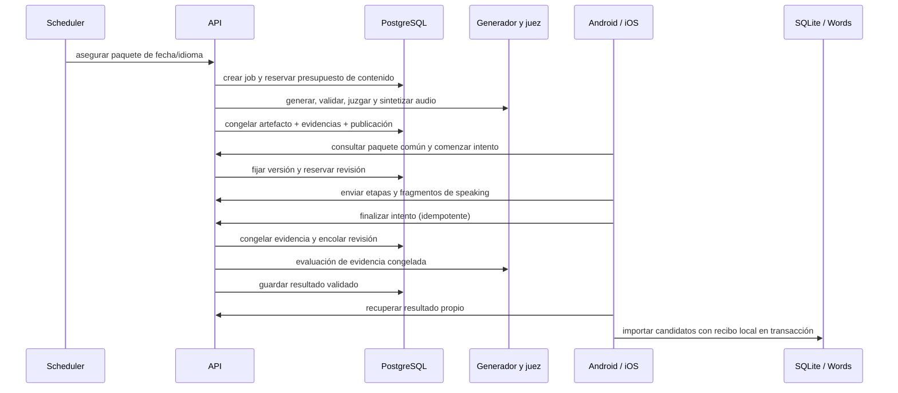

# Design: daily-practice

## 1. Decisión y arquitectura

Construir un módulo diario independiente de los exámenes: **contenido compartido
inmutable + intento privado + revisión durable + importación local a Words**.
Reutilizar transporte, identidad, proveedores, componentes y patrones de jobs;
no reutilizar contratos de examen como si describieran práctica conversacional.

Todos los módulos siguientes son **propuestos**, salvo los puntos de integración
de la sección 2. Los nombres de fichero nuevos son el destino del plan, no una
afirmación de existencia actual.

| Módulo nuevo | Responsabilidad |
|---|---|
| `services/api/src/daily-content.ts` | Esquemas, perfil lingüístico, proyecciones y claves |
| `services/api/src/daily-generation.ts` | Generador, juez, TTS y publicación del hash aprobado |
| `services/api/src/daily-jobs.ts` | Jobs durables, reservas, leases y reconciliación |
| `services/api/src/daily-attempts.ts` | Ownership, CAS, etapas, cierre y snapshot |
| `services/api/src/daily-review.ts` | Evaluación, verificación de citas y resultado persistido |
| `services/api/src/daily-admin.ts` | Operaciones editoriales y auditoría |
| `services/api/admin-ui/features/daily-practice.js` | Estado puro/normalización del panel |
| Cores móviles `DailyPractice.*` | DTO, reducer de estados, presupuesto y ayudas |
| Cores móviles `DailyWordsImport.*` | Reglas puras de importación, identidad y recibos |

No es necesario un servicio de colas nuevo ni una dependencia nueva: la propuesta
usa PostgreSQL y el ciclo de vida del proceso API. El número de workers es fijo
y configurable, inicialmente 1 de generación y 1 de revisión por despliegue.
Los leases evitan duplicados entre réplicas; más réplicas no multiplican el
presupuesto global de proveedor.

## 2. Integraciones verificadas con el código actual

| Punto actual | Qué se conserva / qué hay que añadir |
|---|---|
| Android `core/DailyPlanEngine.kt:7–39`; iOS `Core/DailyPlanEngine.swift:5–40` | Mantener el recomendador existente; añadir tarjeta diaria separada, sin transformar `PlanStep` en estado remoto |
| `services/api/src/auth.ts:86–91`; `app.ts:802–832` | Invitados hospedados ya tienen account ID y bearer; usar ownership de cuenta y las puertas hospedadas existentes |
| `live-provider.ts:7–32`; `hosted-voice.ts:96–100` | Contexto actual limitado y con claves cerradas; añadir binding explícito, nunca esconder identidad diaria dentro del prompt |
| Android `AppViewModel.kt:3192–3250`; iOS `ConversationCoordinator.swift:1412–1560` | Ambas plataformas ya tienen revisión de escenario; reutilizar verificación/UI donde encaje, no afirmar que falta iOS por leer specs antiguas |
| `hosted-helpers.ts:123–128,206–217` | Ventana de 120 s, sin persistencia de texto/resultados y sin replay; no sirve como cola durable diaria |
| `migrations/003_hosted_sessions.sql:20`; `live-provider.ts:132–136` | No hay transcript autoritativo almacenado; la evidencia diaria es nueva y declaradamente enviada por cliente |
| Android `RecallEngine.kt:15–60`, `AppViewModel.kt:2900–2918`; iOS `Core/RecallEngine.swift:15–68`, `App/Storage.swift:678–695` | Reutilizar guardado de expresiones y single writer; palabras derivadas de assessments no son una tabla mutable |
| Android `core/Models.kt:309–312`; iOS `Core/Models.swift:410–415` | `source` solo admite `lesson`/`lookup`; no introducir `daily` en ese campo |
| `shared/db/schema.sql:613–626`; `LearningDbDao.kt:450–525` | Respetar owner y lenguaje, y adopción legacy; añadir recibos sin eludir admission de escritura |
| `services/api/src/progress.ts:9–27,112–121` | Ledger de contadores, no sincronización cloud de Words ni de su borrado |
| `app.ts:70–73,231–242`; `admin-auth.ts:32–53` | Admisión pública central y autenticación admin por cookie/Origin; no inventar un token CSRF existente |
| `level-tests-generation-jobs.ts:41–83`, `level-tests-scheduler.ts:123–190` | Referencias de locks, clock inyectado, jobs y resultados desconocidos; no modificar su comportamiento semanal |

Estas líneas son localizadores del estado inspeccionado, no números estables.
Antes de implementar, leer símbolos actuales y cambios locales concurrentes.

## 3. Fechas, identidades y contenido común

- Fecha editorial `YYYY-MM-DD` calculada por servidor en UTC. El móvil muestra
  la fecha y «UTC» en ayuda; no decide el día cambiando su reloj o zona horaria.
- Clave pública del día: `(language, editorialDate)`. Una única publicación
  activa por clave, sin `accountId`, nivel ni segmento de población.
- `packageVersionId` UUID identifica el artefacto inmutable completo.
  `contentHash` cubre la proyección pública sin claves; `artifactHash` cubre el
  artefacto privado completo. No se comparan ni intercambian estos dos hashes.
- Canonicalización: objetos con claves ordenadas por codepoint, arrays en su
  orden, JSON UTF-8 compacto y SHA-256. Sin `localeCompare`, fechas implícitas,
  floats de tiempo ni números fuera del rango entero seguro de JSON.
- Evitar autorreferencias: `contentHash` se calcula sobre el DTO público sin su
  propio campo contentHash. `textHash` cubre contenido privado textual, claves,
  rúbrica y perfil, excluyendo descriptor de audio y campos hash. `artifactHash`
  cubre private_payload completo con descriptor/checksum de audio; no incluye
  su propia columna hash, evidencias de juez, estados o timestamps de ejecución.
- Publicar exige juez sobre el `textHash` exacto y validación final que vincule
  ese texto y el audio verificado al `artifactHash` exacto. Editar texto/claves
  invalida juez; editar audio invalida verificación de audio y validación final.
- Tras el primer intento del día la publicación queda consumida y no se puede
  sustituir por otra versión ese día. Puede retirarse; nunca se cambia el paquete
  silenciosamente para los siguientes alumnos.
- Antes del primer intento, una sustitución explícita exige nueva revisión y
  CAS sobre la publicación. Paquetes precargados antiguos dan `package_changed`
  al comenzar; el alumno recarga antes de producir respuestas.
- Un intento iniciado conserva su snapshot y puede retomarse sin caducidad por
  fecha o tiempo, incluso tras medianoche. Cada fecha tiene su cupo configurado;
  comenzar el día siguiente nunca sobrescribe un intento previo.

## 4. Generación y publicación

### Ciclo del paquete

`draft → validating → judging → audio_pending → ready → published`.
Fallo de puertas → `rejected`; fallo técnico → `failed`; envío con resultado
desconocido → `unknown`. `published → withdrawn` es terminal para nuevos intentos.
Los estados de job son separados: no se representa «publicado» solo porque el
proceso acabó sin excepción.

1. Scheduler propone mañana a las 03:00 UTC; al arrancar reconcilia hoy y mañana
   si falta contenido. Un lock por `(language,date)` impide generación simultánea.
2. Congelar perfil, esquema, prompt, rúbrica, versiones de configuración y límite
   operativo antes del primer envío. No copiar secretos al snapshot.
3. Generar topic y paquete, sin datos personales. Validar esquema, IDs únicos,
   claves, idioma, objetivos, ayudas, respuestas válidas, duraciones previstas y
   límites de [contracts.md](contracts.md).
4. Juez independiente en una petición distinta, sin el razonamiento del generador:
   comprueba claves, distractores, coherencia temática, referencia B1–B2,
   accesibilidad con ayudas y ausencia de instrucciones peligrosas. Devuelve
   `pass/fail/uncertain` con evidencia por ID; solo `pass` permite continuar.
5. Sintetizar listening con voz permitida por perfil. Verificar MIME, duración,
   tamaño, checksum y correspondencia del script; el mismo audio sirve a todos.
   Si el TTS devuelve alineación, verificar cobertura del script; si no la devuelve,
   comprobación independiente por STT stub en tests y proveedor autorizado en
   evaluación real. Un archivo de audio válido no prueba su contenido lingüístico.
6. Recalcular artefacto incluyendo metadatos del audio; la revisión textual se
   vincula al hash del subdocumento revisado y una validación final al hash completo.
   Publicar solo si ambas evidencias y el perfil coinciden. La publicación no
   requiere firma docente obligatoria: registrar la revisión como automatizada.
7. En modo automático, publicar tras puertas completas. En modo manual queda
   `ready` hasta que un operador publica ese mismo hash. Nunca aprobar un `fail`
   o `uncertain` por un botón de override.

Reintentos: máximo 2 envíos de generación por idioma/día, solo si se conoce
que el anterior no se envió o terminó con fallo definitivo. `unknown` bloquea
reintento automático y publicación hasta reconciliación documentada. No se
vuelve a llamar al proveedor porque un cliente repita HTTP.

Si no hay paquete válido hoy, mostrar indisponibilidad y acceso a actividades
existentes. No etiquetar contenido de ayer como hoy ni recurrir a un paquete
inglés cuando se pidió un idioma no habilitado.

## 5. Intento y speaking

Estados remotos: `in_progress → review_pending → completed|partial`. No existe
estado `expired` causado por tiempo o por cambio de día. El usuario puede dejar el intento incompleto y continuarlo después, sin caducidad temporal, desde el estado guardado.
Una retirada puede cerrar un intento `partial` con `stopReason=content_withdrawn`.

`completed` exige preparación, listening y práctica enviados (al menos una
respuesta no vacía por sección), speaking sellado y al menos 2 fragmentos learner
no vacíos, sin stopReason de interrupción. No exige respuestas correctas ni
ausencia de ayudas. Si falta cualquiera de esas evidencias, `partial`.
`review_pending` permanece mientras el job esté failed/unknown; reviewState
explica el fallo. No se llama completed a una revisión que nunca pudo admitirse.

Etapas locales: `preparation → listening → speaking → practice → review`.
Se puede omitir una etapa, pero debe quedar como `skipped`; no se inventan
respuestas correctas ni progreso. El estado visual distingue `loading`, `ready`,
`saving`, `offline_pending`, `review_pending`, `review_failed` y `needs_attention`.

### Binding de voz

Añadir `dailyAttemptId?: UUID` al body cerrado de creación hospedada. La ausencia
conserva byte a byte la semántica previa. Con binding:

- Resolver cuenta, intento, paquete, speaking y lenguaje del servidor.
- Exigir intento propio `in_progress`, no caducado ni retirado y presupuesto oral.
- No aceptar `instructions`/`history` arbitrarios: campos presentes se rechazan
  con `invalid_daily_context`, no se ignoran con éxito. El servidor construye
  el contexto común; historia solo de fragmentos de ese intento al reanudar.
- Abrir máximo una sesión de voz activa por intento mediante constraint/lock;
  conexiones secuenciales solo para recuperar fallos técnicos, sin cota pedagógica
  de turnos o duración. La misma clave idempotente no abre otro segmento.
- Aplicar también gates de saldo, consentimiento, readiness y revocación existentes.
  No conceder minutos nuevos por usar daily ni cobrar audio dos veces al reintentar.
- El modo diario es una rama explícita de política. No pasar por constructores
  que añadan preferencias de reto, errores históricos o vocabulario personal.

El briefing contiene topic, papel del tutor, apertura, anclas temáticas,
expresiones y ayudas comunes, y una señal de cierre ofrecida al alumno. El tutor
habla en `en`, escucha lo que aporta el alumno, responde a ello y lo invita a
continuar sin conducirlo como un cuestionario. El alumno puede introducir ideas
relacionadas con el topic; la conversación es dinámica, bidireccional y no tiene
conteo prefijado de preguntas o turnos. Solo acaba cuando el alumno la cierra o
finaliza su intento. El tutor no interrumpe para corregir: registra evidencia y
entrega feedback al cierre, usando recasts naturales solo cuando no corten el hilo.

Al pausar/cambiar de pantalla se cierra el transporte y se espera confirmación
antes de liberar una nueva sesión. Las respuestas tardías se conservan solo si
pertenecen al owner, generación de restauración, intento y segmento originales.
Cambiar de cuenta nunca muestra ni importa el resultado de la anterior.

## 6. Evidencia, revisión y costes

La API **no escucha una grabación autoritativa de este modo**. Recibe fragmentos
acotados del cliente con IDs, rol, texto, segmento y marcas de ayuda. Se guardan
en tablas diarias nuevas, no en `hosted_sessions`. La revisión es formativa y
se presenta como basada en transcripción enviada; no acredita identidad, audio
real ni competencia certificada. No se usa para premios o progresión CEFR.

Finalizar fija `inputHash` sobre respuestas, ayudas y fragmentos aceptados. La
evaluación consume ese snapshot y las claves privadas; no el estado mutable de
la UI. Ya no se admiten cambios de respuestas después del cierre. La API calcula
la corrección cerrada y pide al LLM la síntesis conjunta y análisis de speaking.

La revisión es un **job diario nuevo**, no una extensión de `scenario_review` ni
de su ventana de 120 segundos. La API persiste salida validada y la sirve al
volver horas después. Reutiliza el adaptador LLM configurado y sus controles
de timeout/secretos, no cambia propósitos ni SQL CHECK de helpers existentes.

Antes de admitir un intento se reserva del presupuesto operativo la cota máxima
de 1 evaluación de 24 KiB de evidencia y hasta 3.000 tokens de salida, según
precio/configuración congelados. Reservas y gasto usan BigInt nanoUSD, serializado
como string. No hay saldo o tarifa nuevos para el usuario por esta revisión.
Contenido/TTS y revisión usan centros de coste distintos. Este modelo financiero
es una propuesta pendiente de aprobación, no una autorización de gasto real.

La reserva admite espera hasta cierre del intento; Si el precio conocido no permite
acotar gasto, falla cerrada la admisión con `daily_budget_unavailable`. El exceso
de respuesta o timeout no produce otra llamada automática. Los límites numéricos
monetarios se configuran por operador antes de habilitar; cero o ausencia bloquea
nuevos trabajos, nunca significa ilimitado.

Estados de revisión: `queued → running → ready|failed|unknown`. Un lease vencido
antes de enviar puede reencolar; vencido después de envío potencial es `unknown`,
no una invitación a duplicar coste. Un proveedor sin recuperación/idempotencia
no permite garantizar exactamente una ejecución externa: se garantiza **no
reenviar automáticamente en incertidumbre**, conservando la reserva y el aviso.
Un fallo conocido pre-envío admite un reintento explícito con la misma operación;
una nueva evaluación tras fallo definitivo requiere reserva nueva y acción
auditada de operador, máximo 2 envíos totales por intento. El usuario puede
reintentar sincronización/lectura, no disparar llamadas facturables sin control.

No se muestran errores con citas no verificadas. Candidato a Words debe apuntar
a una pregunta fallada, expresión marcada por usuario o fragmento del alumno.
Se permite enseñar la forma correcta que no aparece en la transcripción, siempre
que esté vinculada a esa evidencia. Esto no prueba que la corrección semántica
sea cierta: el alumno puede descartarla y el piloto debe revisar calidad.

## 7. Administración y operación

Vista «Daily practice» separada de exámenes: calendario/fecha UTC, idioma,
estado de publicación y consumo, generación activa por `runId`, fallos, métricas
y coste agregado. Detalle editorial incluye claves y ayudas, no respuestas de
alumnos. Sin buscador de conversaciones personales en esta entrega.

Acciones: configurar interruptores/presupuestos/voz/perfil; generar; consultar
job; revisar preview; publicar hash válido; rechazar borrador; retirar con motivo;
reconciliar un job desconocido con referencia externa verificable o declararlo
sin recuperación, conservando gasto/exposición. No hay botón de «borrar error»
que elimine evidencia de coste. Toda mutación exige motivo y auditoría transaccional.

Reutilizar cookie admin Secure/HttpOnly/SameSite y política Origin existente;
no debilitarla ni afirmar que existe un token CSRF obligatorio. Formularios con
cambios sin guardar no ejecutan contra una configuración que parece guardada.
Los watches se atan a `runId` y contexto de vista; respuestas tardías no pisan
una fecha/idioma seleccionados después. Error persistente junto a la acción,
botón de reintento, foco conservado y estado anunciado accesiblemente.

## 8. Disponibilidad, métricas y despliegue

Flags propuestos persistidos en configuración diaria: `readEnabled`,
`newAttemptsEnabled`, `generationEnabled`, `autoPublishEnabled`,
`enabledLanguages=["en"]`. Inicialmente todos false. Desactivar generación no
retira publicaciones; desactivar nuevos intentos permite terminar los admitidos.
`readEnabled=false` oculta descubrimiento público, pero no recuperación privada
de intentos/resultados. Retirada es una acción diferente y explícita.

Instrumentos propuestos en `metrics.ts`:
`palique.daily.generation.jobs`, `palique.daily.review.jobs`,
`palique.daily.job.duration`, `palique.daily.attempts` y
`palique.daily.words.imports` (este último mediante eventos content-free del
cliente). Labels cerrados: idioma habilitado, etapa, estado y código de error;
nunca topic, fecha, usuario, palabra, fragmento o attempt ID como label.
Las rutas HTTP ya reciben RED; jobs necesitan estos contadores.

El panel muestra fallos/desconocidos, disponibilidad de hoy/mañana, tiempo de
generación/revisión y gasto/reservas por centro. Coste real se deriva de registros
de proveedor/operación, nunca de convertir arbitrariamente tokens a euros.

Activación propuesta: migraciones y rutas oscuras → fixtures/stubs → Android e
iOS → E2E aislado → evaluación de proveedores autorizada → piloto autorizado →
activación expresa. Un despliegue no queda autorizado por aprobar este documento.
Apagar flags es el rollback habitual; no hacer down-migration destructiva.
